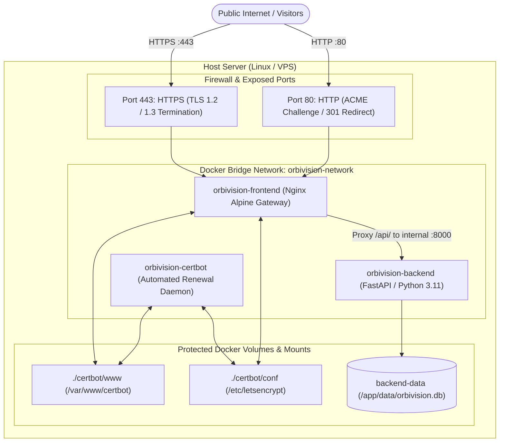

# ORBIVISION — Production Deployment & Security Architecture Guide

> **Official Deployment & Operations Playbook for ORBIVISION Creative Technology Agency**  
> Founders: **Om Makwana** (`826458om@gmail.com`) & **Trushal Parmar** (`trushalmparmar96@gmail.com`)

---

## 1. System Architecture Overview

ORBIVISION uses a hardened, zero-trust edge gateway architecture. All external traffic terminates at the containerized Nginx gateway. The FastAPI backend and SQLite database are fully isolated inside a private bridge network and are never exposed to the public internet.



---

## 2. DNS & Domain Configuration

Configure the following DNS records with your DNS provider (Cloudflare, Namecheap, Route 53, etc.) pointing to your server's public IPv4/IPv6 address:

| Type | Host / Name | Target / Value | TTL | Purpose |
| :--- | :--- | :--- | :--- | :--- |
| **A** | `@` (orbivision.com) | `YOUR_SERVER_PUBLIC_IP` | 300s | Apex domain routing |
| **A** | `www` (www.orbivision.com) | `YOUR_SERVER_PUBLIC_IP` | 300s | Subdomain alias |
| **AAAA** (Optional) | `@` | `YOUR_SERVER_IPV6` | 300s | IPv6 apex routing |

---

## 3. Host Firewall & Port Isolation

Run the following UFW / iptables rules on the host to ensure only Nginx is accessible:

```bash
# Allow SSH (adjust port if non-standard)
sudo ufw allow 22/tcp

# Allow HTTP and HTTPS for Nginx edge gateway
sudo ufw allow 80/tcp
sudo ufw allow 443/tcp

# Ensure Backend (Port 8000) is NEVER exposed publicly
sudo ufw deny 8000/tcp

# Enable firewall
sudo ufw enable
```

> [!IMPORTANT]
> The backend container uses `expose: ["8000"]` rather than `ports: ["8000:8000"]`. This strictly confines communication to the internal Docker bridge network (`orbivision-network`), making direct port scanning or exploitation of port 8000 from the internet impossible.

---

## 4. HTTPS & SSL Certificate Management

The containerized Nginx setup uses Let's Encrypt certificates mounted from `./certbot/conf` to `/etc/letsencrypt`.

### Initial Certificate Issuance (First-Time Boot)

1. **Start the containers with bootstrap certificate:**
   On initial launch, `frontend/docker-entrypoint.sh` automatically detects if production certificates exist. If missing, it generates a temporary self-signed certificate so Nginx starts on port 80 and 443 without crashing.
   ```bash
   docker compose up -d frontend backend
   ```

2. **Obtain genuine Let's Encrypt certificates via Certbot:**
   ```bash
   docker compose run --rm certbot certonly \
     --webroot \
     --webroot-path=/var/www/certbot \
     -d orbivision.com \
     -d www.orbivision.com \
     --email admin@orbivision.com \
     --agree-tos \
     --no-eff-email
   ```

3. **Reload Nginx to activate genuine SSL certificates:**
   ```bash
   docker compose exec frontend nginx -s reload
   ```

### Automated Certificate Renewal

The `certbot` container in `docker-compose.yml` runs a background renewal check every 12 hours:
```yaml
certbot:
  image: certbot/certbot:latest
  entrypoint: "/bin/sh -c 'trap exit TERM; while :; do certbot renew; sleep 12h & wait $${!}; done;'"
```
When certificates are within 30 days of expiry, Certbot renews them automatically. To reload Nginx after renewal, add a lightweight host cron job (`crontab -e`):
```cron
0 3 1,15 * * cd /opt/orbivision && docker compose exec -T frontend nginx -s reload >/dev/null 2>&1
```

---

## 5. Rate Limiting & Reverse Proxy Security

### Trusting Reverse Proxy Headers (`X-Forwarded-For` Defense)

By default, direct public requests can spoof the `X-Forwarded-For` header to impersonate any IP address and bypass rate limiting.

ORBIVISION enforces strict peer validation:
- The backend evaluates `request.client.host`.
- Forwarded headers (`X-Forwarded-For`, `X-Real-IP`) are **ONLY** parsed if `request.client.host` matches a verified entry in `TRUSTED_PROXIES` (`127.0.0.1`, `::1`, Docker subnets `172.16.0.0/12`, `10.0.0.0/8`).
- Direct public requests have all forwarded headers discarded, preventing spoofing attacks.

### Limitations of In-Memory Rate Limiting

The built-in sliding-window limiter operates in memory:
- **Strengths:** Zero external dependencies, ultra-fast (sub-millisecond evaluation), thread-safe.
- **Single-Instance Limitation:** State is bound to the single Python worker process. If multiple worker processes or multi-server clusters are introduced behind a load balancer, rate limits are per-node rather than cluster-wide.

### Recommended Redis Migration for Multi-Instance Deployments

When scaling horizontally to multiple backend nodes, replace `InMemoryRateLimiter` with Redis sorted sets:

```python
# Production Redis Sliding Window Rate Limiter
import time
import redis

redis_client = redis.Redis.from_url("redis://redis-cluster:6379/0", decode_responses=True)

def check_redis_rate_limit(key: str, max_requests: int, window_seconds: int):
    now = time.time()
    pipe = redis_client.pipeline()
    # 1. Remove entries older than sliding window
    pipe.zremrangebyscore(key, 0, now - window_seconds)
    # 2. Add current request timestamp
    pipe.zadd(key, {str(now): now})
    # 3. Count requests in window
    pipe.zcard(key)
    # 4. Set key expiration to window duration
    pipe.expire(key, window_seconds)
    _, _, count, _ = pipe.execute()
    
    if count > max_requests:
        return False, window_seconds
    return True, 0
```

---

## 6. Admin Authentication & Credential Management

- **Zero Hardcoded Secrets:** No default credentials exist in source code. `ADMIN_PASSWORD` is loaded strictly from environment variables.
- **Startup Protection:** `seed_database()` verifies existing records and **NEVER** resets or overwrites an existing admin password on application reboot.
- **Rotation Procedure:**
  To change the production admin password:
  1. Generate a new 24+ character password.
  2. Update `ADMIN_PASSWORD` in `.env`.
  3. Execute secure in-database rotation:
     ```bash
     docker compose exec backend python -c "
     import config, auth, db_manager
     new_hash = auth.hash_password(config.ADMIN_PASSWORD)
     admin = db_manager.get_admin_by_username_or_email(config.ADMIN_USERNAME)
     db_manager.update_admin_password_hash(admin['id'], new_hash)
     print('Admin password updated successfully')
     "
     ```

---

## 7. Database Backups & Disaster Recovery

The SQLite database resides in the named Docker volume `backend-data` mounted at `/app/data/orbivision.db`.

### Hot Backup (Zero Downtime)
SQLite supports live online backups without taking the application offline:

```bash
# Create timestamped hot backup
docker compose exec backend python -c "
import sqlite3, datetime
src = sqlite3.connect('/app/data/orbivision.db')
bck = sqlite3.connect(f'/app/data/backup_{datetime.datetime.now().strftime(\"%Y%m%d_%H%M%S\")}.db')
src.backup(bck)
bck.close()
src.close()
print('Live backup created')
"
```

### Daily Backup Cron Job
Add to host crontab (`crontab -e`):
```cron
0 2 * * * docker run --rm -v orbivision_backend-data:/data -v /var/backups/orbivision:/backup alpine cp /data/orbivision.db /backup/orbivision_$(date +\%Y\%m\%d).db
```
